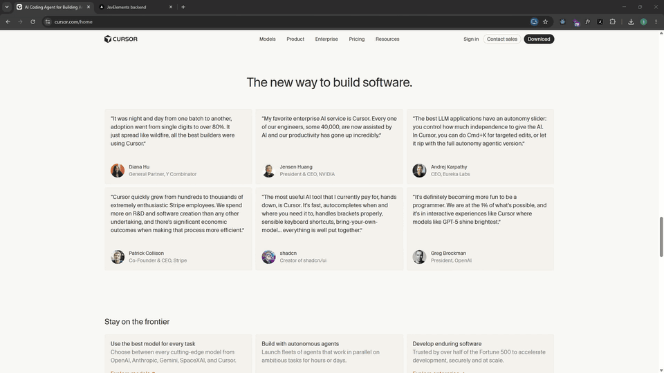

# JevElements

Chrome extension that turns any section of a website into a ready-to-run Next.js app. Pick a section and you get a zip with the section's assets and two prompts: `PROMPT.md` rebuilds it 1:1, and `REMIX.md` designs a new section inspired by it.



## Tech stack

| Part | Powered by |
| --- | --- |
| Extension | Vite, TypeScript, Chrome Manifest V3 |
| Backend | Next.js, TypeScript |
| AI | Jev by TypeSafe, with Vercel AI Gateway as fallback |

## Setup

```bash
# 1. Backend (keep it running while you capture)
cd backend
pnpm install
cp .env.example .env   # add TYPESAFE_API_KEY
pnpm dev

# 2. Extension
cd frontend/jevelements
pnpm install
pnpm build
```

Load `frontend/jevelements/dist` at `chrome://extensions` → **Load unpacked**.

## Usage

1. **Capture a section.** Click the toolbar icon (or press `Alt+Shift+E`), then click a section. When the capture finishes, `<section>.zip` downloads.
2. **Extract it.** Go to your `Downloads` folder, right-click the zip and choose **Extract All**.
3. **Install.** Open the extracted folder in your editor and run `pnpm i`.
4. **Build it.** In your coding agent, tag `@PROMPT.md`, attach a screenshot of the section, and send it. Plan mode is preferred.
   - **Or remix it.** To get the same section in a new layout, tag `@REMIX.md` instead. The remix keeps every word, image, font and color, and rearranges them with one or two layout moves that suit the kind of section (a testimonials grid might get its header moved to the side and its cards turned into a bento). To steer it, edit **Your brief** at the top of `REMIX.md` first. Leave a line as it is and the agent decides.
     - **Move:** pick a move from the list under the brief, e.g. `side-header + bento`.
     - **Preview:** `on` to have the agent propose three options and wait for your pick.
     - **Scope:** `style` to change the palette and typeface too, from the **Palette** and **Type** lines.
   - **Another round.** Say "another one" in the same chat, or tag `@REMIX.md` again. Each round gets its own `components/remix-<n>/` folder and a line in `remix-log.md`. Open `/rounds` to compare them all.

## More

- [Extension](frontend/jevelements/README.md)
- [Backend](backend/README.md)

## Checks

`pnpm verify` runs typecheck, lint and unit tests. Run it in each of `backend/` and `frontend/jevelements/`.
